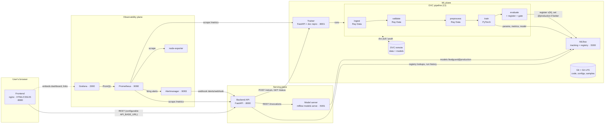
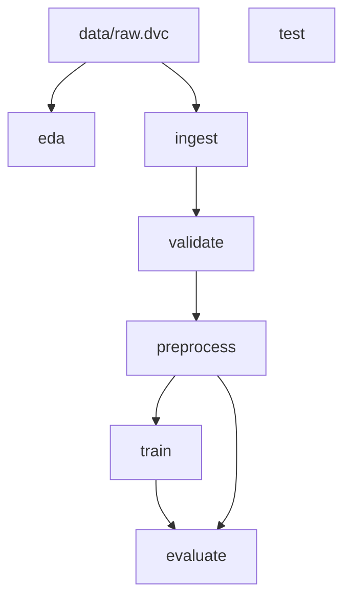

# LeafGuard: Architecture

**Rohan Sirsewad (DA24B023)** · DA3408 AI Operations (Prof. Sudarsun) · IIT Madras

## 1. System diagram

**The automated feedback loop:**
1. Users upload photos.
2. The backend computes brightness and blur, plus drift z-scores against the training baseline.
3. Prometheus scrapes these and evaluates `rules.yml`.
4. When `InputBrightnessDrift`, `InputBlurDrift` or `AccuracyDrop` fires, Alertmanager calls the backend webhook.
5. The backend calls the trainer's `POST /retrain`, which runs `scripts/retrain.sh`:
   - It imports feedback-labelled uploads into `data/raw` and runs `dvc add` to version them.
   - It then runs `dvc repro -f evaluate`.
6. The evaluate stage registers the new version and moves `@production` only if the new model is at least as good.
7. The model server and backend notice the alias change (they poll every 30 s) and hot-swap to the new model.

## 2. Blocks

| Block | Technology | Responsibility |
|---|---|---|
| **Frontend** | nginx, vanilla HTML/CSS/JS | Three pages: *Check a leaf* (upload, result, heatmap, feedback), *Pipeline console* (DAG status, runs, registry, drift, logs, retrain/rollback, embedded Grafana) and *Help* (user manual). It talks to the backend only through `API_BASE_URL`, which is injected at container start. |
| **Backend API** | FastAPI, Pydantic, prometheus_client | Validates uploads, computes image-quality and drift stats, gets the prediction from the model server (falling back to a local copy of the model), builds Grad-CAM heatmaps, collects feedback, exposes metrics, proxies pipeline control, and receives Alertmanager webhooks. Uploads are stored encrypted with Fernet. |
| **Model server** | `mlflow models serve` | The MLflow "APIfication" of the model: serves `models:/leafguard/<version of @production>` over REST. A supervisor script restarts it when the alias moves. |
| **MLflow** | MLflow tracking server (SQLite + artifact store) | Holds experiments, runs, params, metrics and artifacts, plus the Model Registry with versions and the `@production` alias. |
| **Trainer** | FastAPI + subprocess `dvc repro` | Runs the CI pipeline on demand, one run at a time. A cooldown prevents alert-driven retrain storms. Exports pipeline metrics (stage durations, throughput, data quality, last F1). |
| **DVC pipeline** | DVC, Ray Data, PyTorch | `ingest → validate → preprocess → train → evaluate`, plus `eda` and `test`. DVC caches every stage and tracks data, models and metrics. |
| **Prometheus** | Prometheus | Scrapes the backend, trainer and node-exporter every 5 s, and evaluates the alert rules. |
| **Alertmanager** | Alertmanager | Groups alerts and routes them to the backend webhook, which turns drift and accuracy alerts into a retrain. |
| **Grafana** | Grafana (provisioned) | The *LeafGuard – Operations* dashboard: traffic, latency, errors, drift, model behaviour, pipeline and host health. |
| **Versioning** | Git, Git LFS, DVC | Git holds code and configs. Git LFS holds the binary test samples and docs images. DVC holds the dataset, processed arrays and model weights (local remote). |

## 3. DVC DAG (the CI pipeline)

Output of `dvc dag`:

| Stage | Command | Key outputs |
|---|---|---|
| eda | `python -m src.data.eda` | `reports/eda/*` (class balance, brightness/blur distributions) |
| ingest | `python -m src.data.ingest` | `data/interim/manifest.csv`, `reports/ingest_metrics.json` |
| validate | `python -m src.data.validate` | `data/interim/valid.csv`, `reports/validation.json` (fails the pipeline if >5% bad or a class is empty) |
| preprocess | `python -m src.data.preprocess` | `data/processed/{train,val,test}.npz`, `labels.json`, `baseline_stats.json` |
| train | `python -m src.train.train` | `models/model.pt`, MLflow run, `reports/train_metrics.json` |
| evaluate | `python -m src.train.evaluate` | registry version, `@production` gate, `reports/eval_metrics.json`, confusion matrix |
| test | `pytest` + `scripts/test_report.py` | `reports/test_summary.json`, `reports/tests/test_cases.md` |

## 4. Deployment
- Everything runs on one machine with `docker compose up -d --build`. No cloud services are used.
- One multi-stage `Dockerfile` builds four Python images that share one dependency layer: `backend`, `trainer`, `mlflow` and `model-server`.
- The frontend has its own `frontend/Dockerfile` (nginx).
- The monitoring services use the official images.

| Port | Service |
|---|---|
| 8080 | UI |
| 8000 | API (`/docs`) |
| 5001 | Model server |
| 5000 | MLflow |
| 8001 | Trainer |
| 9090 | Prometheus |
| 9093 | Alertmanager |
| 3000 | Grafana |
